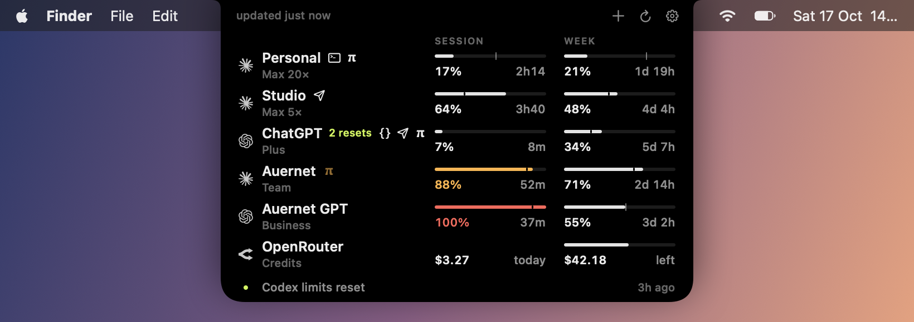
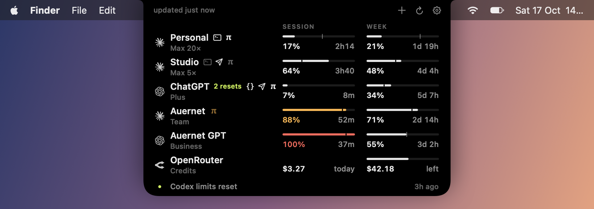

# Brim

Your AI subscription limits, wrapped around the MacBook notch.



Closed, it's a sliver either side of the camera: one hairline per account on the left, the next reset on the right.


Hover the notch and it opens: every account's 5-hour session and weekly limit, how far through each window you are (the tick), and a countdown to each reset. On a screen without a notch it becomes a small pill in the menu bar.

- **Claude** and **ChatGPT / Codex**, as many accounts of each as you like. Every account Claude Code, Codex, Hermes Agent or OMP is signed in to on this Mac is picked up automatically; add others with a browser sign-in.
- **Account switching**: each row shows the tools signed in as that account. Hover a row and the other tools appear dim; click one to sign that tool in as this account. The login it had is parked in Brim and kept fresh, so switching back needs no new sign-in.
- **OpenRouter**: credit left and today's spend. A key in `$OPENROUTER_API_KEY` (or `~/.config/secrets/global.env`) is picked up by name, never copied; or add one with **Add OpenRouter Key…** / `brim add openrouter`.
- **Alerts** at thresholds you pick, when a balance runs low, when unused weekly quota is about to expire, when a limit resets, and when OpenAI or Anthropic announce a reset in public ([resets.albastov.com](https://resets.albastov.com)).
- **Agent-friendly**: `brim status --json`, plus hooks that get every alert as JSON, so an agent can spend leftover quota or pause heavy work.

## Install

macOS 14+, Xcode command line tools.

```sh
git clone https://github.com/SignedAdam/brim && cd brim
make install        # builds, links brim onto your PATH, runs at login
```

## Command line

```
brim status [--json] [--fresh]    usage per account
brim add claude|codex             sign in to another account
brim add openrouter [--env VAR]   add an OpenRouter key (stdin, or by env var name)
brim list | rename | remove       manage accounts
brim where [--json]               what each tool is signed in as, and what Brim has parked
brim switch <account> <tool>      tool: claude-code, codex, hermes, omp
brim alerts                       recent alerts, JSON lines
brim quit
```

Everything lives in `~/.brim` (owner-only).

## Switching



Claude and ChatGPT refresh tokens rotate: once anyone uses one, every other copy is dead. So a login is never in two places. It is either installed in one tool, which owns and refreshes it while Brim only reads it, or parked in `~/.brim/vault.json`, where Brim refreshes it before it expires. A switch takes the tool's current login out, parks it, and puts the other account's in; the first switch to a tool opens the browser once (usually one click on Authorize). Brim polls usage with its own sign-in, separate from every tool.

- **Claude Code**: the Keychain item `Claude Code-credentials` and `oauthAccount` in `~/.claude.json` (the rest of that file is left byte for byte). Running sessions pick it up on their next request.
- **Codex**: `~/.codex/auth.json`. Running sessions keep the account they started with; new ones use the new one.
- **Hermes Agent**: one switch covers every home (`~/.hermes` and each profile). Claude gets a one-year inference token (what `claude setup-token` makes), written to `ANTHROPIC_TOKEN` in each `.env` that sets it; Codex goes in each home's `auth.json`. Gateways pick it up on their next turn.
- **OMP**: `~/.omp/agent/agent.db`. Brim keeps one live Claude and one live ChatGPT login there, waits out OMP's refresh lease, and leaves dead logins and other providers alone. Running instances pick it up on their next credential lookup.

Every write is atomic and preceded by a backup in `~/.brim/backups` (the last 20 per store). If a step fails, the tool keeps the login it had.
